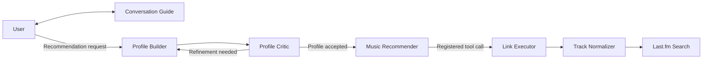

# Conversational Multi-Agent Music Recommender

A personal high-school project exploring how collaborative LLM agents can turn a conversation into mood-aware music recommendations. The project combines conversational preference discovery, a profile-review loop, explicit agent routing, and external music-search tools in a single notebook.

The central question is: **Can a recommendation system understand what a listener wants right now through dialogue, without requiring a pre-existing listening-history dataset?**

## System concept

The system gathers musical preferences and emotional context through Socratic-style conversation. It then separates profile construction, critical review, recommendation, and link retrieval into specialized roles. The profile is an intermediate textual representation that connects what the user says to what the recommender selects.

The design explores personalization as a coordinated reasoning workflow: gather context, interpret it, review it, and use tools to make the resulting suggestions discoverable.

## Architecture



The diagram shows the main information flow. A group-chat manager maintains shared conversation context, while `select_next_speaker` combines LLM-based decisions with fixed transitions to determine which role speaks next. Link-search results are returned to the group conversation.

### Components and responsibilities

| Component | Responsibility |
| --- | --- |
| `user_agent` | Represents the human participant and accepts interactive input. |
| `conversation_guide` | Elicits mood, musical preferences, and useful context without recommending tracks. |
| `profile_builder` | Produces a textual profile of the listener's characteristics and preferences. |
| `profile_critic` | Reviews omissions and requests revisions, considering the information actually available. |
| `music_recommender` | Selects tracks using the profile and preferences; requests links through a registered tool. |
| `link_executor` | Executes `get_track_link` on behalf of the recommender. |
| `track_normalizer` | Converts artist and track names into Chinese or English search terms according to the artist's nationality. |
| Routing agent | Interprets user requests and critic feedback to select the next stage. |
| `recommendation_manager` | Coordinates the six-member group chat and its shared message history. |

The normalizer and routing agent are auxiliary agents rather than additional members of the main group.

### Orchestration and feedback

The routing agent examines the latest message when the speaker is the user or profile critic. Its output selects among three routes:

| Signal | Next role | Intended trigger |
| --- | --- | --- |
| `ROUTE_PROFILER` | Profile builder | A recommendation request or a profile needing refinement. |
| `ROUTE_RECOMMENDER` | Music recommender | An accepted profile or feedback about unavailable links. |
| `ROUTE_GUIDE` | Conversation guide | Continued preference discovery or other input. |

Other transitions are explicit: guide → user, builder → critic, and recommender → link executor. Unrecognized routing responses and routing exceptions fall back to the guide; after the executor, the default transition returns to the user.

The critic uses `PROFILE_COMPLETE` or `REFINE_PROFILE`. Completion means the profile is sufficient for the available context, including cases where the user supplied little information. The group chat is bounded to 30 rounds; the outer initiation call specifies 100 turns. The routing implementation retains a decision-counting structure, but currently uses one routing agent.

### Recommendation and tool pipeline

The final recommender is instructed to suggest two musical styles with three tracks each unless the user specifies otherwise, consider the listener's current feelings, and avoid tracks they are tired of hearing.

`get_track_link(track_name, artist_name)` delegates name normalization to an LLM, parses its JSON response, calls Last.fm's `track.search` endpoint, and returns the normalized track, artist, and up to three search-result URLs. This separates recommendation reasoning from external lookup. The URLs are Last.fm track pages, not audio streams.

## What makes the idea forward-looking

- **Conversational context as an input:** The workflow can begin with a new listener's stated preferences and current situation.
- **An intermediate user model:** A profile makes the handoff between dialogue and recommendation explicit.
- **Separate generation and review:** A critic can challenge the profile before it informs recommendations.
- **Hybrid orchestration:** Semantic routing handles intent and feedback, while explicit transitions define the workflow.
- **External tool integration:** Track lookup adds retrieved music metadata to the agent conversation.

The main contribution is the integration of these ideas into an inspectable prototype. Its design demonstrates systems thinking about agent responsibilities, information flow, and feedback; it does not establish a benchmarked improvement in recommendation quality.

## Run the notebook

Use Python and Jupyter with `requests` available. The notebook retains its original installation cells for AG2, the OpenAI client, and `pyautogen`; dependency versions are unpinned.

Set credentials before starting Jupyter:

```bash
export DEEPSEEK_API_KEY="your-deepseek-api-key"
export LASTFM_API_KEY="your-lastfm-api-key"
jupyter notebook music-recommend.ipynb
```

Run the cells in order, then interact through the final chat cell. The configured model is `deepseek-chat`. Earlier cells preserve separate role definitions and a profiling-group example; the final section assembles and launches the main group-chat workflow. An alternative sequential-chat configuration remains in the notebook with its initiation call commented out.

## Scope and validation

This is an exploratory notebook, with session-local conversation context and LLM-generated profiles. It has no trained ranking model, persistent user database, or quantitative recommendation evaluation. Search results are not independently verified for exact track matches or URL availability.

Archive validation covered 32 Python code cells and 21 stubbed routing and termination checks. Live model calls, Last.fm behavior, and recommendation quality were not tested during maintenance.

## Project history

The original high-school workflow is preserved. October 2026 maintenance standardized English prompts, comments, and identifiers, moved credentials to environment variables, and documented the architecture. Git history records the archive work separately from the original development.
